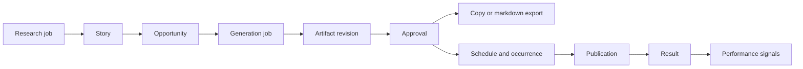

# Flows

The lifecycle below is the one in [`../CURRENT_ARCHITECTURE.md`](../CURRENT_ARCHITECTURE.md) section 2, plus the export path in decision `DEC-05`. Boxes are records, not new services.

## Sign-in

The browser gets a session from a password, from Google, or from Auth0 Universal Login. Auth0 access tokens can also be presented as bearer tokens. Cookie-changing API calls require the CSRF token. The gate and the Auth0 exchange are specified in [`AUTH0.md`](AUTH0.md) and implemented from `server/index.ts`.

## Research to artifact

Providers fan out, duplicates drop, the time window applies, and evidence excerpts are stored. A story requires a completed job when it is built from research. Generation freezes a policy snapshot and writes copy only. The database trigger from migration `0007` rejects in-place edits of an artifact payload. Claim bindings from the productization work sit in `artifacts.attribution` as `claim_evidence_v1`, not in the channel payload. That shape is decision `DEC-02`.

## Approval to delivery

Only an approved artifact can be scheduled. Export and manual publish logging do not call a social network. A real publication takes a single-flight lease, records that the provider was called, and refuses a blind retry. Channel tokens resolve for the owner of the row. The five adapters are X (through xQuick), Threads, Instagram, LinkedIn, and YouTube.

## Failure

A provider outcome that is not clearly success or failure becomes `unknown` and waits for reconcile. Publishing-class Jev decisions fail closed when that layer is enabled. Research triage fails open. Tests must be started with `npm run test:unit` or `npm run test:db`, which load `server/testing/hermeticEnv.ts`. A raw `node --test` can inherit live credentials from the shell.

## What this page does not claim

GitHub Actions on `ae8ced2` did not pass the end-to-end jobs. Walking this diagram in production is not verified by that run. See [`BUGS.md`](BUGS.md).
